# Оценка 3

](../Screenshots/01_git_status.png)

1. Первая строка On branch main показывает текущую ветку.

](../Screenshots/02_git_log.png)

2. Видна история коммитов: хэш, автор, дата, сообщение. Если коммитов нет, git пишет, что их нет.

](../Screenshots/03_sort.png)

3. Создал файл с функцией сортировки

](../Screenshots/04_git_status.png)

4. Файл в разделе Untracked files: git его видит, но не отслеживает.

 ](../Screenshots/05_add.png)

5. Файл помещён в индекс (stage), то есть подготовлен к коммиту.

](../Screenshots/06_git_status.png)

6. Файл в Changes to be committed.

](../Screenshots/07_commit.png)

7. "Закомитил/закоммитил" файл.

](../Screenshots/08_git_status.png)

8. Cтатус.

](../Screenshots/09_comm.png)

9. Добавил комментарий в файл.

](../Screenshots/10_git_status.png)

10. Файл в Changes not staged for commit как modified.

](../Screenshots/11_add.png)

11. Файл лежит в stage.

](../Screenshots/12_git_status.png)

12. Файл в Changes to be committed как modified.

](../Screenshots/13_comm.png)

13. Добавил ещё один комментарий. 

](../Screenshots/14_commit.png)

14. Закоммитил файл.

](../Screenshots/15_git_status.png)
](../Screenshots/15_git_log.png)

15. Статус: modified. В логе 2 коммита про sort.c

](../Screenshots/16_add_commit.png)

16. Добавил в stage и закоммитил.

](../Screenshots/17_git_push.png)

17. Всё отправлено успешно!

# Ветки

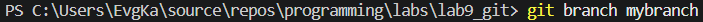
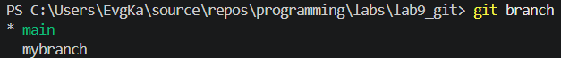

1-2. Создана ветка mybranch. Видны две ветки: main и mybranch. Звёздочка * стоит у main, так как переключения ещё не было.

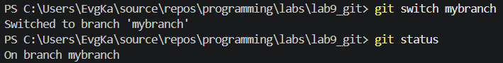

3-4. Переключились на новую ветку. Меняется только первая строка: On branch mybranch.

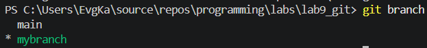

5. Убедились по *, что находимся на mybranch.

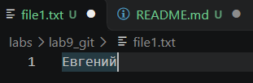

6. Создан файл file1.txt с именем. Git пока считает его untracked.

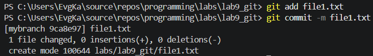

7. Файл проиндексирован и закоммичен в ветку mybranch.

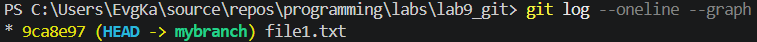

8. Верхний коммит помечен HEAD -> mybranch.

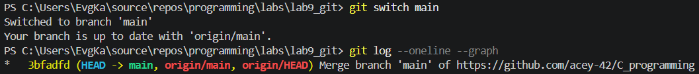

9-10. Вернулись на главную ветку. Файл file1.txt из папки исчез: он есть только в коммите mybranch. 

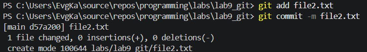

10-11. В main появился свой новый коммит, независимый от mybranch.

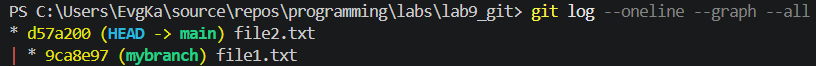](../Screenshots/26_git_log.png)

12. У main и mybranch теперь разные последние коммиты.

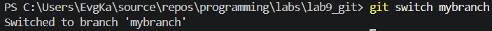](../Screenshots/27_switch.png)

13. Вернулись на ветку mybranch.
14. file2.txt пропал: он закоммичен только в main. При переключении git подставляет содержимое выбранной ветки.

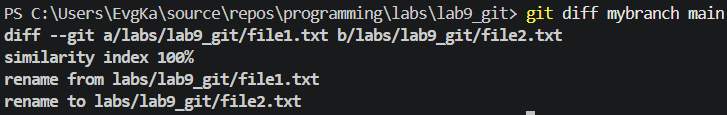](../Screenshots/28_git_diff.png)

15. Строки с - есть в mybranch, строки с + есть в main. Видно, что file1.txt есть только в mybranch, а file2.txt только в main.

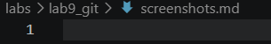](../Screenshots/29_screenshot.png)
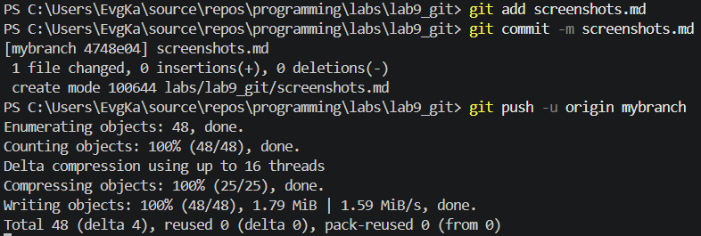](../Screenshots/30_add_commit_push.png)

16. Добавил, закоммитил и отправил под новой веткой.

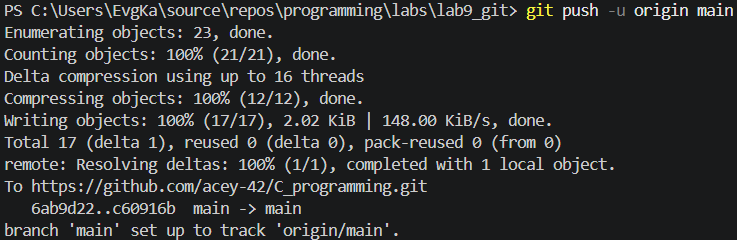](../Screenshots/31_push.png)

17. Вернулся в main и запушил.

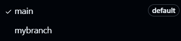](../Screenshots/32_branch.png)

Всё на месте! 